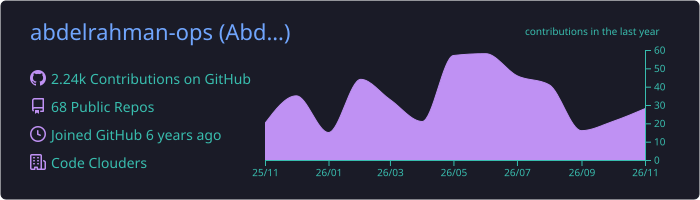
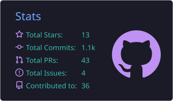
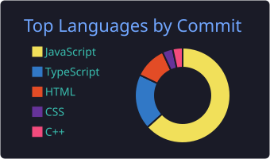
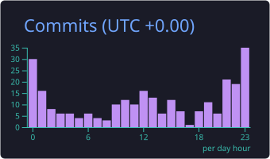
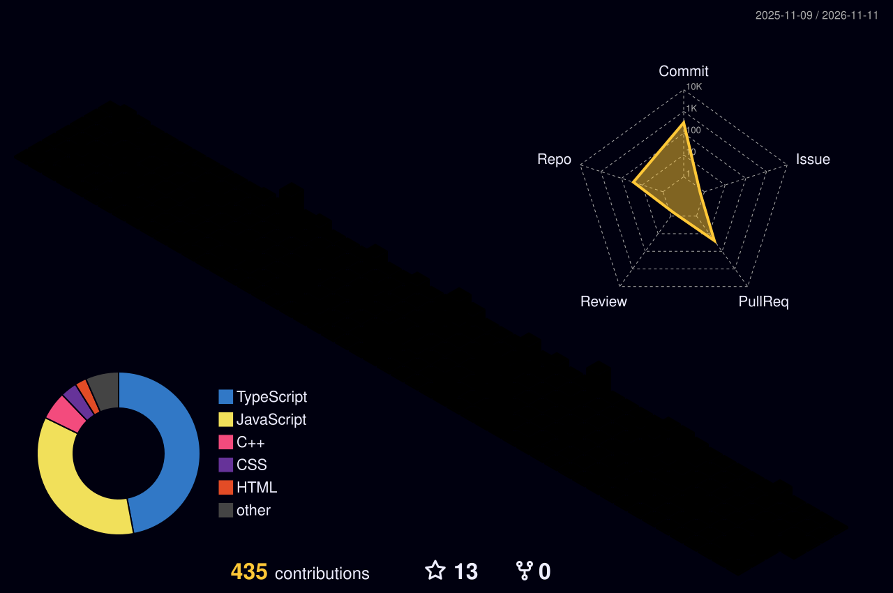

<!-- ═══════════════ HEADER ═══════════════ -->
<div align="center">


<a href="https://git.io/typing-svg">
  
</a>

<br/>

<a href="https://www.linkedin.com/in/abdelrahman-ataa-b557b8219/"></a>
<a href="mailto:abdelrahmanataa17@gmail.com"></a>
<a href="https://x.com/abdelrahmanside"></a>
<a href="https://leetcode.com/abdelrahmanataa17/"></a>
<a href="https://codeforces.com/profile/abdelrahmanataa17"></a>

<br/><br/>


</div>

<br/>

<!-- ═══════════════ ABOUT ═══════════════ -->
## `>_ whoami`

```yaml
name:        Abdelrahman Ataa
role:        Full-Stack Engineer @ Code Clouders
education:   B.Sc. Computer Engineering, Mansoura University
location:    Mansoura, Egypt 🇪🇬   # open to relocating to Cairo
achievement: 🥉 3rd Place, Samsung Innovation Campus Hackathon
exploring:   [Cloud Architecture, System Design, Cybersecurity, AI Integration]
open_to:     [Full-time roles, Collaborations, Open source]
```

I build software that is powerful under the hood and intuitive on the surface: clean architecture, solid fundamentals, and interfaces people actually enjoy using.

<br/>

<!-- ═══════════════ TECH STACK ═══════════════ -->
## `>_ stack --list`

<div align="center">

**Languages**<br/>


**Frontend**<br/>


**Backend**<br/>


**Databases**<br/>


**Cloud & DevOps**<br/>


**AI / ML**<br/>


</div>

<br/>

<!-- ═══════════════ CURRENT FOCUS ═══════════════ -->
## `>_ focus --now`

<table>
  <tr>
    <td align="center" width="33%">
      <h3>📚 Learning</h3>
      Cloud Architecture<br/>System Design<br/>Cybersecurity
    </td>
    <td align="center" width="33%">
      <h3>⚡ Building</h3>
      AI-powered applications<br/>Scalable web services<br/>Full-stack products
    </td>
    <td align="center" width="33%">
      <h3>🚀 Sharpening</h3>
      Algorithms &amp; data structures<br/>Database engineering<br/>Open source contributions
    </td>
  </tr>
</table>

<br/>

<!-- ═══════════════ STATS ═══════════════ -->
## `>_ stats --github`

<div align="center">






<br/><br/>


<br/><br/>



</div>

<br/>

<!-- ═══════════════ SNAKE ═══════════════ -->
<div align="center">

<picture>
  <source media="(prefers-color-scheme: dark)" srcset="https://raw.githubusercontent.com/abdelrahman-ops/abdelrahman-ops/output/github-snake-dark.svg" />
  <source media="(prefers-color-scheme: light)" srcset="https://raw.githubusercontent.com/abdelrahman-ops/abdelrahman-ops/output/github-snake.svg" />
  
</picture>

</div>

<br/>

<!-- ═══════════════ FOOTER ═══════════════ -->
<div align="center">

<sub>Built with precision • Driven by curiosity</sub>


</div>
